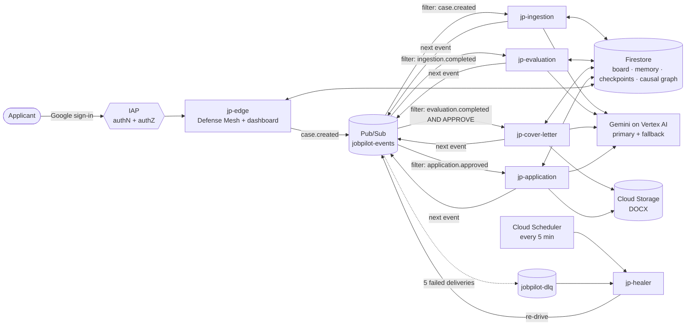

# JobPilot Level 2: Decentralized Specialist Agents on Google Cloud

Level 1 was one monolithic agent. Level 2 splits the work across **four independent specialist agents**
that never call each other. They coordinate through events, a **shared message board** and **shared
persistent memory**, protected by an **Agent Defense Mesh**, with **IAP** in place of an API gateway.
**Incremental checkpoints**, a **causal dependency graph** and **auto-healing** make the system fault tolerant
and auditable. Deployment uses PowerShell and gcloud only (no Terraform).



## How each requested pattern is implemented

| Pattern | Implementation | Code |
|---|---|---|
| **Decentralized specialist agents** | 4 Cloud Run services, each its own ADK agent with its own **FCoT Instruction Contract** and N=3 Recap→Reason→Verify loop. No orchestrator: each reacts to events (choreography) via its own filtered Pub/Sub push subscription. | `jobpilot/agents/*.py`, `contracts.py` |
| **Central message board** | `cases/{id}/board` in Firestore. Every agent reads a digest of it as part of its FCoT *Recap* and posts after each task. Visible in the dashboard. | `core/board.py` |
| **Shared persistent memory** | Case memory (`cases/{id}/memory/{key}`, versioned with optimistic concurrency) + long-term user memory (`users/{email}/memory/profile`, application history). Each agent may only write the keys its contract allows. | `core/memory.py` |
| **Agent Defense Mesh** | IAP JWT verification → RBAC + ownership → per-user rate limit → input scanning (prompt injection, invisible unicode, PII redaction, SSRF-safe URLs, optional **Model Armor**) → **capability policy** (who may emit which event / write which memory key / post which board topic) → output scanning (PII, contract leaks) → service-identity checks on private endpoints. Every block is a node in the causal graph. | `core/mesh.py` |
| **Incremental checkpoint** | Every agent step **and every FCoT iteration** is persisted. A crash or redelivery resumes at the next step/iteration. Idempotency (finished work is never redone), leases with heartbeats (no double execution), at-most-once guard on the actual submission. | `core/checkpoint.py` |
| **Causal dependency graph** | Every human action, event, agent run, step, tool call, memory write, board post, mesh block and healer action is a node with edges to its causes. Viewable as Mermaid in the dashboard; `GET /api/cases/{id}/lineage/{node}` answers "why did this happen?"; mirrored to Cloud Logging. | `core/causal.py` |
| **Auto-healing** | Retry with exponential backoff (transient 429/5xx) → **model failover** (primary → fallback Gemini) behind a **shared circuit breaker** → Pub/Sub retry policy + **dead-letter topic** → **healer** (Cloud Scheduler every 5 min) re-drives expired leases, dead letters and quiet cases, and gives up cleanly after 5 attempts → Cloud Run restarts crashed containers. | `core/healing.py`, `core/llm.py` |
| **GCP authN/authZ instead of an API gateway** | **IAP enabled directly on Cloud Run** for the edge (Google sign-in, `roles/iap.httpsResourceAccessor`); the app re-verifies the signed IAP JWT. Agents and healer are private (**Cloud Run IAM**: only the Pub/Sub push / Scheduler identities may invoke). **One service account per component** with least-privilege IAM. | `services/edge.py`, `scripts/level2/*` |

### Event protocol
| Event | Emitted by | Consumed by |
|---|---|---|
| `case.created` | edge (user submits) | ingestion |
| `ingestion.completed` | ingestion | evaluation |
| `evaluation.completed` (`decision` attribute) | evaluation | cover letter, only when `decision = APPROVE` |
| `documents.ready` | cover letter | the dashboard shows **Approve** |
| `application.approved` | edge (human clicks Approve) | application |
| `application.submitted` | application | (terminal) |

A DENY stops the flow at evaluation. Nothing is submitted without a human approval event, and the
application agent re-checks the policy itself (APPROVE, cover letter present, approver = owner, no fraud red flags).

### Files
```
jobpilot/
├── settings.py
├── core/        store · bus · board · memory · causal · mesh · checkpoint · healing · llm · runtime · blobs
├── agents/      contracts (per-agent FCoT ICs) · tools (persisted FCoT loop, guards, audit)
│                ingestion · evaluation · cover_letter · application
├── services/    edge (IAP + dashboard API) · agent_service (push + healer) · main (SERVICE_ROLE)
├── static/      index.html dashboard
├── rag/         policies/*.yaml · policy_store · retriever (BM25 + embeddings) · grounding · embeddings
├── testing/     scripted_llm (offline stand-in for Gemini)
├── local.py     whole system in one process
└── requirements.txt
Dockerfile.level2 · cloudbuild.level2.yaml
scripts/level2/  setup_level2.ps1 · deploy_level2.ps1 · _common.ps1
tests/level2/    46 tests: pipeline, crash/resume, failover, DLQ + healer, mesh, RBAC, IAP, RAG grounding, swipe
```
Level 1 (`job_app_agent/`) is untouched. Level 2 reuses its deterministic scoring and DOCX rendering.

---

## 1. Run it locally (PowerShell, VS Code terminal):
```powershell
Set-ExecutionPolicy -Scope Process -ExecutionPolicy Bypass
.\.venv\Scripts\Activate.ps1                     # or: python -m venv .venv first
pip install -r jobpilot\requirements.txt pytest

python -m jobpilot.local --demo                  # fully offline (scripted model)
# open http://localhost:8080
```
Paste any resume and job description, click **Evaluate**, watch the board, checkpoints and causal graph fill in,
then **Approve & apply**.

With real Gemini (uses your `gcloud auth application-default login` credentials):
```powershell
Copy-Item jobpilot\.env.example jobpilot\.env
code jobpilot\.env                               # set GOOGLE_CLOUD_PROJECT; keep GOOGLE_CLOUD_LOCATION=global
python -m jobpilot.local
```

Tests:
```powershell
pytest -q tests\level2        # 46 passed (Level 1 tests: pytest -q tests\test_level1.py tests\test_e2e_offline.py)
```

## 2. One-time Google Cloud setup
```powershell
$env:PROJECT_ID = "$projectid"
gcloud auth login
gcloud config set project $env:PROJECT_ID
.\scripts\level2\setup_level2.ps1 -ProjectId $env:PROJECT_ID              # add -EnableModelArmor for Model Armor
```
This creates the APIs, bucket, Firestore, Artifact Registry repo `jobpilot`, Pub/Sub `jobpilot-events` +
`jobpilot-dlq` (+ `jobpilot-dlq-sub`), eight service accounts (`jp-edge`, `jp-ingestion`, `jp-evaluation`,
`jp-coverletter`, `jp-application`, `jp-healer`, `jp-push`, `jp-scheduler`) with least-privilege roles, the
Gmail secret placeholder and the IAP service agent. It's safe to re-run.

## 3. IAP OAuth setup for projects without an organization (one time)
Personal Gmail projects have no Cloud organization, and IAP then needs an OAuth app configured first.
In the Cloud Console:
1. **Google Auth Platform → Branding**: app name `JobPilot`, your support email, then **Save**.
2. **Google Auth Platform → Audience**: User type **External**. While in *Testing*, add every Gmail address that should
   use JobPilot under **Test users**.
3. If the deploy in step 4 still fails at `--iap`, open **Cloud Run → jp-edge → Security**, choose
   **Identity-Aware Proxy**, save once in the console, then re-run the deploy script.

Workspace/organization projects can skip this step.

## 4. Deploy
```powershell
.\scripts\level2\deploy_level2.ps1 -ProjectId $env:PROJECT_ID -Users you@gmail.com
```
What it does:
1. Builds one image with Cloud Build (`Dockerfile.level2`).
2. Deploys six Cloud Run services from it: `jp-ingestion`, `jp-evaluation`, `jp-cover-letter` and `jp-application` (private), `jp-healer` (private), and `jp-edge` (IAP).
3. Grants run.invoker only to the right identities: the IAP agent → edge, the push SA → agents, the scheduler SA → healer.
4. Creates one **filtered push subscription per agent**, with retry backoff (10s–600s), a 600s ack deadline, and dead-lettering after 5 attempts.
5. Creates the Cloud Scheduler job `jp-healer` that runs every 5 minutes.
6. Grants IAP access to the `-Users` you list.

Open the printed `https://jp-edge-…run.app` URL and sign in with Google.

Options: `-SkipBuild` (redeploy config only), `-EnableModelArmor`, `-AdminEmails a@x.com`, `-GeminiModel`, `-FallbackModel`,
`-EnableEmail -ApplicantEmail you@gmail.com` (after storing a Gmail token: `python scripts\create_gmail_token.py`,
then `gcloud secrets versions add gmail-oauth-token --data-file=token.json`).

Give someone else access later:
```powershell
gcloud iap web add-iam-policy-binding --resource-type=cloud-run --service=jp-edge --region=us-central1 `
  --member=user:friend@gmail.com --role=roles/iap.httpsResourceAccessor
```

## 5. Operate and observe
```powershell
# Logs per agent (causal-graph nodes and mesh blocks are structured JSON)
gcloud run services logs read jp-evaluation --region us-central1 --limit 50
# Run the healer now instead of waiting 5 minutes
gcloud scheduler jobs run jp-healer --location us-central1
# Anything stuck in the dead-letter queue?
gcloud pubsub subscriptions pull jobpilot-dlq-sub --limit 5
```
In the dashboard, each case shows its status, score, documents, the **message board**, **checkpoints** (steps done,
FCoT iterations, attempts, last error) and the **causal graph**. Failed cases have a **Retry** button.

## Security model in one paragraph
Only IAP-authenticated users reach `jp-edge`. The app re-verifies the signed IAP JWT (audience
`/projects/NUMBER/locations/REGION/services/jp-edge`) and applies RBAC, ownership checks (other users' cases return 404)
and rate limits. User input is normalized, scanned for prompt injection (blocked with a 422), stripped of SSNs, card
numbers, bank numbers and secrets, and URLs are SSRF-checked. Agents treat all documents as untrusted, may only emit
the events and write the memory keys their contract allows (forged events are dropped), and their outputs are
scanned before they're stored. Agent and healer endpoints aren't reachable by users at all: Cloud Run IAM admits
only the Pub/Sub and Scheduler identities, and the app checks the caller's email again. Each component runs as its
own service account, so a compromised cover-letter agent, for example, can't read the Gmail secret or change a score.

---

## Upgrade: RAG role policies (anti-hallucination) + swipe-to-apply

### 1. Role policies as the RAG knowledge source
Each **role policy** is the standard profile of a role: summary, context, experience levels, core and preferred
skills, tools, certifications, responsibilities, keywords and evaluation guidance. Seven ship in
`jobpilot/rag/policies/`: DevOps, SRE, Cybersecurity, Cloud, Product Manager, Software and Data Engineer.
On first start they're **seeded into Firestore**, and from then on Firestore is the source of truth.

- **Updatable:** admins edit them in the dashboard (**Role policies** tab) or via `PUT /api/policies/{id}`. Every
  save creates a new **version**, keeps the full **history** and can be **rolled back**. Saves are scanned by the
  Defense Mesh, so nobody can plant instructions in a policy. Changes reach every agent immediately, with no redeploy.
- **Adding a role:** in the Role policies tab, open any policy, change `id`/`title`/content and save it under the new
  id. Or add a YAML file to `jobpilot/rag/policies/` and deploy; seeding adds missing roles and never overwrites edits.
- **Retrieval:** BM25 keyword search over policy sections by default. At today's size (a handful of roles),
  that's all you need. When the library grows, add `-EnableEmbeddings` to the deploy to switch on hybrid
  keyword + `gemini-embedding-001` vector search (768-dim vectors stored next to each chunk in Firestore). If an
  embedding call fails, it falls back to keyword search.
- **Who sees policies:** admins and reviewers see the **Role policies** tab and API; applicants don't. Applicants
  still see, on each of their own applications, which role standard was used, which of the posting's skills
  their resume shows or lacks, and any warning or cap, so every decision stays explainable.
- **The job posting comes first.** The policy only counts for skills, tools and certifications that the *posting
  itself mentions*. Policy skills the posting doesn't ask for are listed as advice ("also common for this role") and
  never lower the score.

How it flows through the agents:

| Agent | What RAG adds | Hallucination guard (enforced in code) |
|---|---|---|
| Ingestion | Matches the posting to a role policy (title/alias + text) | Drops extracted skills/certifications that aren't literally in the resume; drops an "apply email" that isn't in the posting |
| Evaluation | Gets the policy's core-skills, experience and guidance chunks plus a `search_role_policy` tool | `score_resume_match` **rejects** scores without citations, or with citations to chunks that were never retrieved. If the skills score is higher than the resume's evidence for the *posting's* skills supports: a small gap gets a **warning**, a large gap (more than 15 points over) is **capped** |
| Cover letter | Gets the policy's responsibilities and keywords to decide what to emphasise | `save_document` **rejects** any document naming a tool, technology or certification (from *any* policy) that the resume doesn't show; the agent must rewrite it |

All of it is visible: the dashboard shows the matched policy, coverage, missing core skills, citations and any
clamping, and every retrieval is a node in the causal graph.

### 2. Swipe-to-apply (no job-board passwords)
- **Profile tab:** each user saves a reusable **application profile**: contact details, links, work authorization,
  sponsorship, relocation, notice period, salary expectation, preferred submission method and standard answers. It has
  **no credential fields**: the API rejects any `password` field or password-like answer. JobPilot never stores or uses
  job-board logins, because Workday accounts are per employer, Greenhouse/Lever have no candidate login, and
  automated logins break on CAPTCHAs and two-factor codes and often violate the sites' terms.
- **Swipe tab:** every role that passed evaluation (≥ 80%) with documents ready becomes a card showing score, strengths,
  gaps and the policy's missing core skills. **Swipe/drag right or press →** to apply, **left or ←** to pass.
  - Right is an explicit human approval and goes through exactly the same checks as the Approve button.
    The submission method is *auto*: email when the posting lists an application address and email is enabled,
    otherwise a **portal packet** with every field and standard answer ready to copy, plus your documents.
  - Left marks the case `dismissed` and records it in your history.

### Updating your deployment (PowerShell)
```powershell
.\scripts\level2\setup_level2.ps1 -ProjectId ######     # adds Vertex AI access for jp-edge (embeddings)
.\scripts\level2\deploy_level2.ps1 -ProjectId ##### -Users o@yourdomain.com -AdminEmails o@yourdomain.com   # full build: code changed
# later, when the policy library grows:  add -EnableEmbeddings
```
Then open the app, fill in **Profile**, evaluate a job, and swipe. Locally: `python -m jobpilot.local --demo`.
In local dev mode `dev@localhost` is an admin, so you can try policy editing.

## Known limits / Level 3 roadmap
- Agents scale to zero, so the first event after idle has a cold start (a few seconds).
- No portal automation: the application agent emails or prepares a hand-off, and never logs in to job sites.
- **Level 3** ideas: agents as independent A2A services discovered at runtime, Vertex AI Agent Engine Memory Bank
  for long-term memory, job discovery from Pub/Sub/Eventarc feeds, BigQuery export of the causal graph for
  analytics, and per-tenant Firestore databases.
